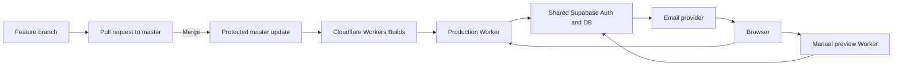

# Requirements

### Goal
Deploy the existing Astro starter to Cloudflare Workers using **one shared hosted Supabase project**, verified-email signup, and automatic production deployment by Cloudflare after PR merges into `master`. Preview and production are separate Workers, not separate databases.

### Scope and gates
- [x] The user approved this plan and requested that its snapshot be saved to `context/deployment/deploy-plan.md`; creating the snapshot is the immediate next action in an execution-capable mode. Approval of the plan does not waive the separate external-change and production gates below.
- [ ] Require every change to `master` to be merged through a pull request, including changes by administrators; direct and force pushes and branch deletion are blocked. No bypass actors are configured.
- [ ] Use Cloudflare Workers Builds, connected directly to the GitHub repository, to build and deploy production after a PR merge updates `master`; GitHub Actions is not used for deployment, verification, or any other workflow.
- [ ] Disable GitHub Actions at the repository level before any planned push and remove the existing `.github/workflows/ci.yml`; if repository settings or required status checks block this, stop and have the owner resolve them before proceeding. No replacement GitHub Actions workflow is introduced.
- [ ] Run lint, type checking, and local smoke tests manually before merging; this plan adds no automatic merge gates for them. PR existence alone does not require independent review or passing tests; existing stricter protections remain unless separately approved. Cloudflare's build must succeed for deployment after merge.
- [ ] Keep the separately named preview Worker manual; disable Cloudflare automatic preview builds, and never deploy untrusted fork code with secrets.
- [ ] Obtain human approval before connecting/enabling automatic production deployment and before the first controlled production PR merge. Subsequent authorized PR merges into `master` authorize automatic deployment; destructive or irreversible external changes still require human approval. The human configures credentials, SMTP, and Supabase settings; the agent never sees or logs secret values.
- [ ] Track each phase through the delivery checklist. After plan approval and before production changes, create `context/deployment/deploy-plan.md` once as the approved snapshot only if absent; never overwrite existing `context/` content or write to `context/archive/`. If the snapshot already exists, stop and ask for an allowed new path.
- [ ] Validate the existing starter only: pet profiles, vaccinations, sharing, and offline PWA functionality are not yet implemented and must not be reported as verified.

### Shared-project safeguards
Preview uses the **production Supabase Auth and database**. Only deploy reviewed, trusted code; use explicitly approved test accounts and data, never real users or destructive tests. Check authorization and RLS before any future application tables contain real data. Worker rollback does not revert Supabase users, data, SMTP, or auth settings.

# Manual Setup

### Before starting
These are **owner-only** actions, performed at the indicated delivery stages; the implementation agent must not impersonate the owner or ask for credential values. Reuse existing accounts and resources when appropriate. Keep passwords, API keys, tokens, confirmation links, and credential-bearing CLI output out of chat, logs, screenshots, and the repository. Record only non-secret identifiers, URLs, prior settings, and completed checkboxes. Dashboard labels can change; use the linked official guides if a label differs.

### 1. Cloudflare account and Worker access
- [ ] If needed, visit [Cloudflare sign-up](https://dash.cloudflare.com/sign-up), enter an email and password, create the account, and verify the email. Otherwise sign in at [Cloudflare dashboard](https://dash.cloudflare.com/). Enable account MFA and store recovery codes privately.
- [ ] Select the intended Cloudflare account, confirm you can administer Workers and Git connections, and review the current Workers plan, quotas and possible charges. Ask the account administrator for access if necessary; do not use someone else's credentials.
- [ ] Open **Workers & Pages**, establish the account's `workers.dev` subdomain if prompted, and record it. No custom application domain or DNS change is required. A `workers.dev` URL is public when enabled; treat preview as public unless access protection is separately configured.
- [ ] Agree with the implementation agent on the exact unique production and preview Worker names. The current default name is `10x-astro-starter`; the preview name must match the eventual `wrangler.jsonc` configuration. Record the exact HTTPS origins `<worker-name>.<account-subdomain>.workers.dev` for both Workers; use no trailing slash when configuring `APP_ORIGIN`.
- [ ] Obtain explicit approval before provisioning Workers or publishing even a placeholder. In **Workers & Pages**, reuse the intended Workers if they exist; otherwise create each using a minimal non-sensitive starter without connecting Git. Verify the name and public route; never replace an existing Worker without approval. If the dashboard requires an initial deploy, it publishes a public placeholder and is **not** the application release. Stop if safe creation or target identity is unclear.
- [ ] On your own machine, install Node `22.14.0`, npm, Git and Docker Desktop; start Docker. In a private terminal at the repository root run `node --version`, `npm --version`, `npm ci`, `npx wrangler --version`, and `npx supabase --version` separately. Run `npx wrangler login`, complete browser authorization, then run `npx wrangler whoami` and confirm the account. If multiple accounts are available, set non-secret `CLOUDFLARE_ACCOUNT_ID` or configure the account ID and recheck. This interactive login is separate from the Builds token; use the existing project-local CLIs without globally installing or upgrading them. If agent noninteractive access is necessary, supply a separately scoped `CLOUDFLARE_API_TOKEN` through a private environment, not chat, arguments or repository files; avoid global API keys and revoke access when no longer needed.

### 2. GitHub PR protection and Actions shutdown
- [ ] Sign in to the GitHub account that owns or administers the intended repository. Confirm repository admin access, permission to push a feature branch and merge a PR into `master`, and permission to install or request the Cloudflare Workers & Pages GitHub App on the owning user or organization. Confirm the repository is the intended source, not a fork.
- [ ] Before any planned push, open **Settings → Actions → General**, select **Disable actions**, and save. Inspect `master` branch protection rules, rulesets and required status checks; preserve unrelated protections and have the owner resolve checks dependent on Actions only with approval. Stop if organization policy or permissions prevent the change; never replace Actions with another workflow.
- [ ] Confirm the GitHub plan and repository visibility support branch protection. In **Settings → Branches → Add classic branch protection rule**, create or edit the effective exact `master` rule and select **Require a pull request before merging** and **Do not allow bypassing the above settings**. Leave **Allow specified actors to bypass required pull requests**, **Allow force pushes**, and **Allow deletions** off. Inspect overlapping rulesets and rule precedence; confirm the effective protections also apply to administrators and integrations, with no bypass actors. Do not remove stricter existing protections without owner approval.
- [ ] PR existence is the required gate; do not add mandatory reviewer approvals or automatic status checks unless separately agreed. Run and record manual checks before merging. If the required protection is unavailable or cannot be enforced, stop; do not silently permit direct pushes or change repository visibility.
- [ ] Let the agent remove `.github/workflows/ci.yml`; when the deployment revision is ready, push it to a feature branch and open a PR targeting `master`. Verify no workflows remain in the PR revision. Keep GitHub as the source repository. Installation/authorization of the Cloudflare GitHub App happens later, after production approval and preflight; it is separate from GitHub Actions.

### 3. One hosted Supabase project
- [ ] Sign in or create an account at [Supabase](https://supabase.com/dashboard). Select the intended organization and existing project, or choose **New project** to create exactly one: choose organization, project name, region and plan, enter a strong database password, store it privately, and wait until the project is ready. Review costs and free-plan availability; do not create a second hosted environment for preview.
- [ ] Confirm the project identity and owner before changes. In the project's **Connect** dialog or **Settings → API / API Keys**, privately find the Project URL and the anon/publishable key. These map to `SUPABASE_URL` and `SUPABASE_KEY`; do not use the service-role/secret key, database password, or personal access token in the app. Do not share even the requested server-only values with the agent.
- [ ] With approval for project-wide settings, record current non-secret Authentication settings for restoration. If signup is enabled, disable it only with approval, accounting for the effect on existing users; keep it disabled while preparing SMTP and the callback, and enable it only for hosted verification after local checks and explicit owner approval.
- [ ] In **Authentication → URL Configuration**, set the production Site URL to the exact production HTTPS origin; add both exact production and preview `<origin>/auth/confirm` URLs to the redirect allowlist. In the email provider settings require email confirmation. In **Authentication → Email Templates**, edit the signup/confirm-signup template so its confirmation link targets `{{ .RedirectTo }}?token_hash={{ .TokenHash }}`. Save without adding arbitrary redirect destinations; this shared template serves both Workers.
- [ ] Create or reuse an SMTP provider account and a sender domain you control. Review provider pricing and limits; follow that provider's domain-verification instructions to add only its required DNS records at the domain's DNS host and wait for verification. This SMTP DNS exception is not an application DNS migration. In Supabase **Authentication → Emails → SMTP Settings**, enable custom SMTP and privately enter the provider's host, port, username, password, sender address and sender name. Save and configure suitable Authentication rate limits; disable provider link tracking if it alters confirmation links. Never paste SMTP credentials into the repository or agent session.

### 4. Local tools and secrets
- [ ] With Docker running, run `npx supabase start` in your private terminal; the checked-in `supabase/config.toml` already exists, so do not run `supabase init`. Inspect the local API URL and anon key privately; `supabase start` and `supabase status` output contain credentials. This disposable local stack is separate from the single hosted project; no Supabase login or hosted-project link is needed. Do not link the hosted project or run `supabase db reset`, `db push`, or `config push` for this deployment.
- [ ] If absent, copy `.env.example` separately to `.env` and `.dev.vars`; preserve existing files unless you have permission to change them. Privately edit both files with the **local** API URL and anon key. After the agent adds `APP_ORIGIN`, use the actual local app origin, e.g. `http://127.0.0.1:4321`. Run `git check-ignore .env .dev.vars` to confirm both are ignored; never commit them.
- [ ] For the baseline smoke test, start `npm run dev` in one terminal and run `npm run smoke` in another against the local server with the configured local Supabase and confirmation disabled. For separate confirmation testing, temporarily configure local `supabase/config.toml` with confirmation enabled, the local Site URL and exact callback redirect, and a local signup template with the hosted token-hash link structure; restart local Supabase as needed. Inspect the local inbox at `http://127.0.0.1:54324` and restore the smoke baseline afterward. Never apply these settings to the hosted project: the smoke script creates users and must never target hosted Supabase.

### 5. Runtime secrets and manual preview
- [ ] After both Worker identities and the shared project are confirmed, open **Workers & Pages → each Worker → Settings → Variables & Secrets**. Add `SUPABASE_URL` and `SUPABASE_KEY` as encrypted runtime secrets for **each** Worker using the same hosted Project URL and anon/publishable key. Check the names and intended Worker, not secret values. Configure each trusted `APP_ORIGIN` via its matching `wrangler.jsonc` environment as directed by the implementation; ensure deployments do not overwrite dashboard-managed settings unexpectedly. Runtime secrets are not the same as Builds variables or GitHub Actions secrets.
- [ ] With the agent, review the trusted preview revision and target, then perform the preview build and deploy using the PowerShell commands in **Build and deploy commands**. Once local confirmation tests pass, approve the project-wide signup enablement only if you accept its potential public exposure. Use an inbox and disposable account you own to verify the emailed confirmation, sign-in, protected route and sign-out. Do not delete test users or change production data without approval.

### 6. Enable automatic deployment and operate it
- [ ] Before connecting Builds, confirm the approved production revision, including workflow removal, is already on `master` via a protected PR merge; confirm Actions is disabled, PR protection is enforced, both runtime secrets and the production origin are correct, preview validation passed, and manual checks passed or are explicitly reported unavailable. If `master` is not ready, ensure no existing production Builds connection can deploy the merge, obtain owner approval, then merge the approved PR while Actions is disabled. This initial merge prepares the safe revision; the later controlled PR verifies the automatic trigger. Obtain separate approval to enable production automation; assume connection may immediately deploy the current branch and stop if that revision is not ready.
- [ ] In Cloudflare, select **Workers & Pages → production Worker → Settings → Builds → Connect**. Follow the GitHub prompts to authorize the Cloudflare Workers & Pages app for your user, and have the repository/organization owner install it with **Only select repositories** access to this repository. These authorization and installation steps are distinct. If the repository is absent, request organization approval or adjust the app installation; do not broaden access unnecessarily.
- [ ] In Builds, select the intended repository, root directory (repository root), production branch `master`, build command `npm run build`, and deploy command `npx wrangler deploy`. Under **Branch control**, disable **Enable Preview Builds**. Confirm Node `22.14.0` and lockfile-based dependency installation are honored, and that no preview `CLOUDFLARE_ENV` is set for production. Review the build/deploy API token permissions, using Cloudflare's generated token or a separately scoped supported user token; it is not the local Wrangler login. Keep credentials private. If any setting cannot be verified before an automatic deploy, stop and resolve it before enabling.
- [ ] After explicit approval, merge a controlled, non-destructive PR into `master`. In the production Worker's **Deployments → View build history**, compare the build commit SHA to the actual resulting `master` commit (which may differ from the PR head after squash or rebase) and check the build and deploy succeeded; inspect the active deployment, HTTPS route, assets and approved owned-account auth flow. Only treat public signup as ready after both Workers' confirmation and SMTP delivery pass. Confirm no GitHub Actions run occurred. Every later authorized PR merge into `master` triggers automatic deployment, without automatic lint, type-check or smoke-test gates.
- [ ] If something goes wrong, stop pushes and disconnect/disable Builds in the production Worker's **Settings → Builds** before rollback; confirm pending builds cannot redeploy a bad revision. Follow **Support and recovery**, obtain approval for production rollback, fix the source before reconnecting, and restore shared Supabase settings separately when necessary. Cloudflare rollback does not undo users, emails or database changes.

References: [Cloudflare account creation](https://developers.cloudflare.com/fundamentals/account/create-account/), [Workers Builds](https://developers.cloudflare.com/workers/ci-cd/builds/), [GitHub integration](https://developers.cloudflare.com/workers/ci-cd/builds/git-integration/github-integration/), [branch control](https://developers.cloudflare.com/workers/ci-cd/builds/build-branches/), [GitHub Actions settings](https://docs.github.com/en/repositories/managing-your-repositorys-settings-and-features/enabling-features-for-your-repository/managing-github-actions-settings-for-a-repository), [GitHub branch protection](https://docs.github.com/en/repositories/configuring-branches-and-merges-in-your-repository/managing-protected-branches/managing-a-branch-protection-rule), [branch protection availability](https://docs.github.com/en/repositories/configuring-branches-and-merges-in-your-repository/managing-protected-branches/about-protected-branches), [Supabase SMTP](https://supabase.com/docs/guides/auth/auth-smtp).

# Technical Design

### Existing integration and decisions
`astro.config.mjs` uses `@astrojs/cloudflare`, server output, and server-only `astro:env` secrets; `wrangler.jsonc` already targets Workers with `nodejs_compat`. The newer Workers decision in `context/foundation/infrastructure.md` supersedes the older Pages hint in `context/foundation/tech-stack.md`; the decision to use Workers Builds without GitHub Actions supersedes its GitHub Actions hint without modifying `context/` artifacts. `.github/workflows/ci.yml` currently runs lint, type checking, build, and local Supabase smoke tests; these checks will be manual except for the Cloudflare build. `src/pages/api/auth/signup.ts` currently redirects to an inbox page but has no server confirmation handler; `src/lib/supabase.ts` supplies SSR cookies. `scripts/smoke.mjs` creates accounts and assumes confirmation is disabled, so it must run only with local Supabase, never against the shared hosted project.



### Prerequisites
The detailed owner checklist for CLI access, local development and the shared hosted project is in **Manual Setup**; perform its actions at the indicated delivery stages. See [Wrangler setup](https://developers.cloudflare.com/workers/wrangler/install-and-update/) and [Supabase CLI setup](https://supabase.com/docs/guides/local-development/cli/getting-started).

### Implementation and configuration
- **Worker environments:** retain the existing default production Worker and add a named `preview` environment in `wrangler.jsonc`, with distinct names and explicit non-inherited bindings/variables where needed. Set an environment-specific trusted `APP_ORIGIN` in the server configuration; configure the same shared project's `SUPABASE_URL` and **anon/publishable** `SUPABASE_KEY` as separate Worker secrets for both environments. Never use a service-role key. Check both Worker names and `APP_ORIGIN` before every deploy.
- **Verified email:** in `src/pages/api/auth/signup.ts`, set the confirmation redirect to the configured environment's exact `/auth/confirm` URL, never a request-supplied host. Add an Astro confirmation page and POST endpoint that verify `token_hash` with `supabase.auth.verifyOtp({ type: 'email', token_hash })` using the existing SSR client; redirect only to fixed local paths. Make the GET show an explicit confirmation button so email security scanners do not consume the one-time token; validate the POST and return safe, actionable errors for invalid, expired, or used links. Apply no-store/referrer protections and avoid logging confirmation tokens. The existing inbox page should clearly describe confirmation and recovery. The shared-project template, allowlist, SMTP setup, and restoration records are specified in **Manual Setup** section 3; do not change global confirmation settings to run smoke tests.
- **Automatic deployment:** use the Cloudflare Workers Builds configuration in **Manual Setup** section 6. The default Astro build must target the existing production Worker, not the named preview environment; verify a local dry run before enabling. Keep Builds credentials separate from local Wrangler login and runtime secrets.
- **Secrets and checks:** put `SUPABASE_URL` and `SUPABASE_KEY` in each Worker's runtime settings and `APP_ORIGIN` in the matching runtime configuration. Cloudflare build variables are separate from runtime secrets; provide server-only build secrets only if the build demonstrably requires them, without printing values. Do not configure GitHub Actions or GitHub Actions secrets. Run lint, type checking, and the local Supabase smoke test manually before merging trusted PRs; this plan adds no automatic gate for those checks or independent review, but existing stricter protections remain unless separately approved.
- **PR protection and Actions:** the owner enforces the exact `master` PR requirement, including administrators, no bypass actors, force pushes or deletion, as in Manual Setup section 2. Inspect existing rulesets and conflicting checks; preserve unrelated protection. Disable Actions before any planned push and resolve any obsolete Actions checks with owner approval; stop if permissions or policy prevent enforcement. Remove the sole repository workflow, `.github/workflows/ci.yml`. Verify repository settings and workflow inventory; GitHub remains the source and Cloudflare Git integration remains enabled.
- **Operations:** use Wrangler CLI and Cloudflare's dashboard; no GitHub Actions, MCP dependency, application DNS change, database schema, or adapter replacement; SMTP sender-domain DNS verification may be required. Update `README.md`, `AGENTS.md`, and `CLAUDE.md` to replace obsolete workflow instructions with Cloudflare Builds and manual verification guidance. Extend `.gitignore` for environment-specific local secret files while preserving any tracked examples.

### Build and deploy commands
Cloudflare runs `npm run build` and then `npx wrangler deploy` for `master`; no local production deploy is part of the normal workflow. The installed Astro integration chooses the Cloudflare environment **at build time**, not only at deploy time ([Astro Cloudflare adapter](https://docs.astro.build/en/guides/integrations-guide/cloudflare/)). For local PowerShell checks, run each command separately and stop on failure:

```powershell

# Manual trusted preview: select its environment before building.

$env:CLOUDFLARE_ENV = 'preview'
npm run build
npx wrangler deploy --dry-run
npx wrangler deploy

# Production preflight only: match the default Cloudflare build target.

Remove-Item Env:CLOUDFLARE_ENV -ErrorAction SilentlyContinue
npm run build
npx wrangler deploy --dry-run
```

Use the generated configuration's target with `wrangler deploy`; do not reuse the preview build for production or assume `--env` at deploy time switches an Astro build. For an emergency manual production deploy, obtain explicit approval and build and verify the default target first. The human pre-provisions each Worker and installs runtime secrets in the correct dashboard environment without sharing values. Verify names only with `npx wrangler secret list --config wrangler.jsonc --env preview` and `npx wrangler secret list --config wrangler.jsonc`.

### Support and recovery
- **CLI setup or authentication fails:** confirm the Node/npm versions, `npm ci`, project-local CLI versions, Docker engine and free local ports. Have the owner reauthorize Wrangler and verify the account and permissions privately; Cloudflare Builds uses its own token. If local Supabase fails to start, inspect Docker resources and service health privately; do not reset data or expose credential-bearing output.
- **Hosted Supabase setup incomplete:** stop before signup tests or public deployment; confirm the selected project is active, both Workers use its correct URL and anon/publishable key, and the user has permission to edit Authentication settings. Restore recorded non-secret settings after a mistaken change; do not create a second hosted project or change remote schemas as a workaround.
- **Wrong Worker or missing secret:** stop before deployment, verify `CLOUDFLARE_ENV`, build output, target name and secret names; rebuild and recheck. Do not paste credentials into logs, tickets, or chat.
- **Signup email missing:** inspect SMTP sender verification, delivery logs, provider quotas and Supabase rate limits; request a fresh confirmation through an approved Supabase workflow. Test with an owned inbox. If link is expired, used, malformed, or intercepted by a scanner, show recovery instructions and obtain a new link.
- **Redirect or cookie failure:** compare the exact origin and path against the Supabase allowlist and Worker `APP_ORIGIN`; verify HTTPS, cookie persistence, and same-origin POST. Never accept arbitrary return URLs.
- **Runtime failures:** use `npx wrangler tail <worker-name>` or the Cloudflare dashboard with sensitive fields excluded; check Worker CPU, request quota and Supabase health separately. Network waiting is not equivalent to CPU time; verify current plan limits rather than relying on stale prices or quota claims.
- **Build did not start or deploy:** check the Cloudflare GitHub connection and repository permissions, configured `master` branch, build history, commit SHA, Node/dependency installation, deploy target, token scope, and Cloudflare quotas. GitHub Actions is not involved. Build and runtime secrets are separate; inspect names and configuration, never values. Retry a failed build only after checking the current build settings and deployed commit; confirm that a failed build or deploy did not activate an unexpected version.
- **PR protection unavailable, bypassed, or merge blocked:** stop before merging or enabling Builds. The owner checks the GitHub plan and repository visibility, effective classic-rule precedence, overlapping rulesets, admin bypass, and any obsolete required Actions checks; obtain approval before modifying existing protections. Do not change visibility, silently weaken the PR policy, or enable Actions as a workaround. If a direct-push test unexpectedly succeeds, leave Builds disconnected, report the changed branch, and resolve it through an approved PR rather than force-pushing or resetting.
- **Bad production deploy:** stop pushes and disable/disconnect automatic builds before recovery; confirm pending builds cannot redeploy the bad revision. Inspect versions with `npx wrangler deployments list` and `npx wrangler versions list`, then use `npx wrangler rollback <version-id>` against the production configuration after approval; recheck auth and public routes. Fix the source before re-enabling automatic builds. Restore Supabase configuration manually if needed; rollback does not undo shared data or external changes.

# Testing

### Validation scope
The delivery stages own the checkboxes; this section specifies the scenarios for those checks rather than creating a second checklist.

- **PR policy:** with Builds disconnected and explicit approval, attempt a harmless prepared direct push as a normal contributor and, if authorized, an administrator; both must be rejected. Record untested roles, inspect bypass/force-push/deletion settings without destructive tests, and follow recovery if a push unexpectedly succeeds.
- **Local checks:** run `npm run lint`, `npx astro check`, and the local-only baseline smoke test. Separately test confirmation-enabled signup, sign-in, session cookies, protected route, sign-out, expired/reused/malformed links, scanner GET without POST, unsafe redirects and cross-origin POSTs. Inspect client assets and logs for secret or token exposure without disclosing values.
- **Build targets:** dry-run both environment-specific builds, checking target and assets. The initial checks establish configuration; the final production dry run checks the exact release revision.
- **Hosted auth:** only with approval, use owned disposable accounts to test emailed confirmation, login, protected routes, cookies and sign-out in each Worker. Account creation affects the shared project; do not delete users or data without human approval.
- **Cloudflare trigger:** correlate the controlled PR merge's actual `master` SHA to the successful build, active deployment and HTTPS route; confirm no GitHub Actions run, no automatic preview builds and no unintended production deployment from non-production branches. Use a safe isolated failure test if available; otherwise record failure behavior as unverified rather than deliberately breaking production.
- **Operations:** check static assets, safe Worker logs and a known-good rollback target. Record pet profiles, vaccinations, sharing and offline/PWA as not implemented, not as passing.

# Delivery Steps

### * Step 1: Protect master and retire GitHub Actions
GitHub requires PRs for `master`, and Actions is disabled with the workflow removed from the proposed changes.

- [ ] As the first action after leaving planning-only mode, save the approved plan in full as `context/deployment/deploy-plan.md`. Recheck that the resolved destination is outside `context/archive/` and does not already exist immediately before creation; otherwise stop and ask for an allowed new path. Do not overwrite any existing `context/` contents.
- [ ] Have the owner follow **Manual Setup** sections 1–2 for account access, GitHub permissions, Actions shutdown, and an effective `master` protection requiring PRs without bypass, including administrators. Defer Worker provisioning to Step 2 and the deployment PR until the revision is ready.
- [ ] Stop if GitHub plan, permissions, or organization policy prevent enforcement; preserve unrelated protections and address obsolete Actions checks with owner approval.
- [ ] With Builds disconnected and approval, verify harmless direct pushes by available contributor and admin roles are rejected; record untested roles and stop if a push unexpectedly succeeds.
- [ ] Remove `.github/workflows/ci.yml` and verify no other repository workflows remain in the feature branch. Prepare the change for a PR to `master` rather than a direct push.

###   Step 2: Configure distinct Worker targets and secret boundaries
Preview and production have explicitly identifiable Workers and share only the intended hosted Supabase project.

- [ ] Complete Worker provisioning and local CLI access in **Manual Setup** section 1. Select the single hosted project and obtain its API values privately as in section 3; defer hosted Authentication and SMTP settings to Step 3.
- [ ] Start local Supabase and prepare ignored local secret files as in **Manual Setup** section 4; defer confirmation testing to Step 3. Preserve existing files and do not link or modify the hosted database.
- [ ] Update `wrangler.jsonc` with a preview environment and explicit environment-specific origin settings; keep the existing production default and adapter.
- [ ] Declare `APP_ORIGIN` as a server-only field in `astro.config.mjs`; validate it as the configured trusted HTTPS origin outside local development.
- [ ] Update `.gitignore` to protect environment-specific secret files.
- [ ] Have the owner install both Workers' runtime secrets as in **Manual Setup** section 5 without exposing values.
- [ ] Check target selection, secret names, and initial preview and production Astro dry-run builds as described under **Testing**; stop if either target or credentials are ambiguous.

###   Step 3: Implement verified-email authentication
A signup confirmation email establishes the existing SSR session safely for either Worker.

- [ ] Update `src/pages/api/auth/signup.ts` to use the configured origin and update the inbox instructions.
- [ ] Add a confirmation page and POST endpoint using `src/lib/supabase.ts` and `verifyOtp`; handle scanner requests, invalid tokens, safe redirects, and sensitive response headers.
- [ ] Have the owner follow **Manual Setup** section 3 to configure the shared Supabase redirect allowlist, email template, confirmation requirement and verified SMTP sender; retain prior setting values for recovery.
- [ ] Run the local auth and security scenarios in **Testing** using the temporary confirmation setup in **Manual Setup** section 4; restore the local smoke baseline afterward.

###   Step 4: Deploy and validate the trusted preview
The preview Worker is running a reviewed build and its shared-Supabase behavior is explicitly verified.

- [ ] Follow the preview deployment and signup-approval instructions in **Manual Setup** section 5 once local verification succeeds; stop if shared-project signup exposure is not approved.
- [ ] Run the preview hosted-auth scenarios in **Testing** with an approved owned disposable account; check static assets.
- [ ] Diagnose SMTP, redirect, quota, and runtime failures using the support steps; stop before production if preview is not healthy.
- [ ] Record that preview affects the same hosted users and data as production; never deploy untrusted fork code with secrets.

###   Step 5: Document automatic deployment and recovery
The proposed revision includes a runbook covering the production trigger, shared-data risks, and safe recovery.

- [ ] Update `README.md`, `AGENTS.md`, and `CLAUDE.md` to remove obsolete GitHub Actions and workflow references, and document Cloudflare Workers Builds as the sole automatic deployment path.
- [ ] Document the owner-only checklist from **Manual Setup** in `README.md`: account creation and verification, access and billing checks, Worker provisioning, GitHub Actions shutdown, `master` PR protection including admin enforcement, Node/Docker setup, private Wrangler authentication, and CLI versus Builds credentials.
- [ ] Document hosted-project selection, dashboard API key and SMTP setup, redirect allowlist and confirmation template; explain local Supabase startup, secret-file setup, local inbox, and separate smoke and confirmation test modes. State that smoke requires both a local server and local Supabase and never targets the shared project. Correct the existing unnecessary `supabase init` instruction.
- [ ] Document Cloudflare dashboard settings, build versus runtime secrets, manual preview commands, and manual lint, type-check, and local smoke-test commands. Explain the protected feature-branch → PR → `master` merge → Cloudflare deploy flow and state that this plan adds no independent review or automatic lint, type-check, or smoke-test gates, while existing stricter protections are retained.
- [ ] Document build troubleshooting, how to disable automatic deployment, approved rollback and the need to fix the source before re-enabling it.
- [ ] Record the shared Supabase risks, SMTP and auth recovery, account side effects, and limitations of Worker rollback; preserve the immutable approved-plan snapshot.

###   Step 6: Enable Cloudflare automatic production deployment
Every successful Cloudflare build of a PR merge into `master` automatically deploys the intended production Worker.

- [ ] Clear preview selection and dry-run the final production revision using **Build and deploy commands**; verify the target and runtime secret names without exposing values.
- [ ] Before each merge, manually run lint, type checking and the local-only smoke test as in **Testing**; report unavailable checks and do not claim they automatically gate merging or deployment.
- [ ] Have the owner follow **Manual Setup** section 6, including the approved initial PR merge, readiness preflight, separate approval to connect Builds, and GitHub App and build configuration. Account for the possibility of an immediate deployment upon connection.
- [ ] After approval, complete the controlled verification PR and the Cloudflare trigger, hosted-auth and operations scenarios in **Testing**. Use an isolated test for failure paths if available; otherwise mark them unverified.